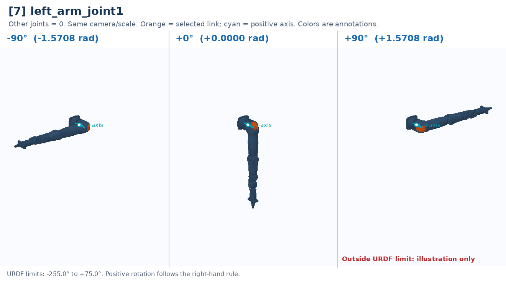

# [7] left_arm_joint1

First shoulder rotation: moves the entire arm about the marked axis.

Controller slot: `action[7]`. Command: **absolute angle in rad**.

Joint: `left_arm_base_link` → `left_arm_link1`. Local positive axis: `[0.0, 1.0, 0.0]`.

URDF position limits: -4.4506 to 1.309 rad. 

The three panels use identical camera and scale. All other joints are zero. Red labels identify illustrative poses that cannot be commanded. This is a motion explanation, not a collision-safe trajectory.

