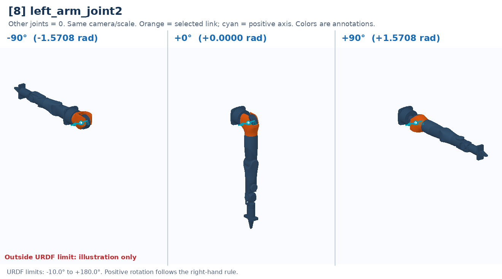

# [8] left_arm_joint2

Second shoulder rotation: swings the entire upper arm about its local axis.

Controller slot: `action[8]`. Command: **absolute angle in rad**.

Joint: `left_arm_link1` → `left_arm_link2`. Local positive axis: `[1.0, 0.0, 0.0]`.

URDF position limits: -0.1745 to 3.1416 rad. 

The three panels use identical camera and scale. All other joints are zero. Red labels identify illustrative poses that cannot be commanded. This is a motion explanation, not a collision-safe trajectory.

