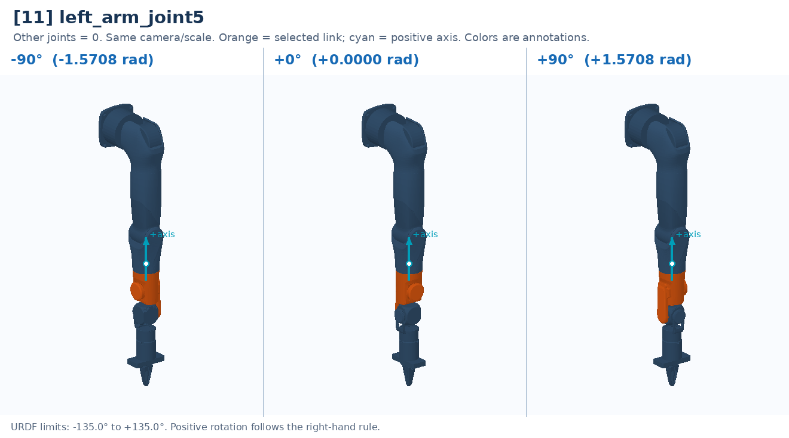

# [11] left_arm_joint5

Forearm axial rotation: rotates the wrist and gripper about the forearm.

Controller slot: `action[11]`. Command: **absolute angle in rad**.

Joint: `left_arm_link4` → `left_arm_link5`. Local positive axis: `[0.0, 0.0, 1.0]`.

URDF position limits: -2.3562 to 2.3562 rad. 

The three panels use identical camera and scale. All other joints are zero. Red labels identify illustrative poses that cannot be commanded. This is a motion explanation, not a collision-safe trajectory.

