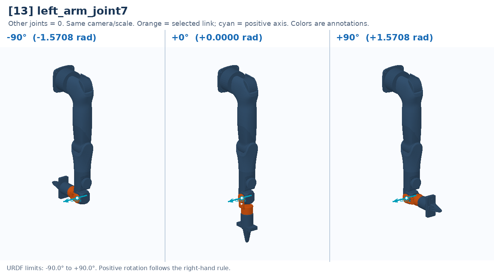

# [13] left_arm_joint7

Final wrist rotation before J8; see the marked local axis.

Controller slot: `action[13]`. Command: **absolute angle in rad**.

Joint: `left_arm_link6` → `left_arm_link7`. Local positive axis: `[1.0, 0.0, 0.0]`.

URDF position limits: -1.5708 to 1.5708 rad. 

The three panels use identical camera and scale. All other joints are zero. Red labels identify illustrative poses that cannot be commanded. This is a motion explanation, not a collision-safe trajectory.

