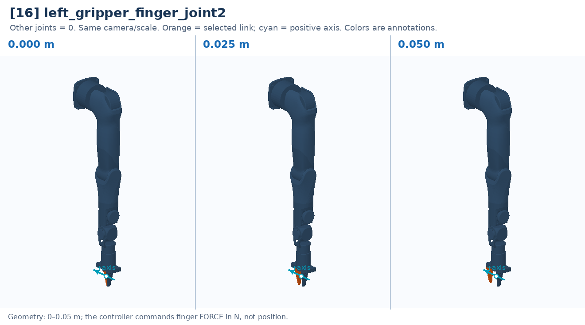

# [16] left_gripper_finger_joint2

Opposing sliding finger. Position 0 m = closed, 0.05 m = open; action is effort in N.

Controller slot: `action[16]`. Command: **force in N, −20…+20**.

Joint: `left_gripper_link` → `left_gripper_finger_link2`. Local positive axis: `[0.0, -1.0, 0.0]`.

URDF position limits: 0 to 0.05 m. 

The three panels use identical camera and scale. All other joints are zero. Red labels identify illustrative poses that cannot be commanded. This is a motion explanation, not a collision-safe trajectory.

