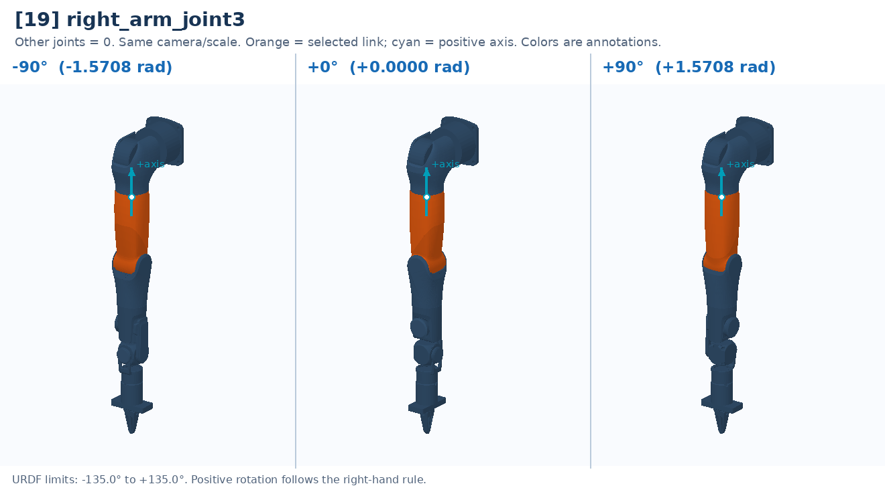

# [19] right_arm_joint3

Upper-arm axial rotation: changes the elbow's bending plane.

Controller slot: `action[19]`. Command: **absolute angle in rad**.

Joint: `right_arm_link2` → `right_arm_link3`. Local positive axis: `[0.0, 0.0, 1.0]`.

URDF position limits: -2.3562 to 2.3562 rad. 

The three panels use identical camera and scale. All other joints are zero. Red labels identify illustrative poses that cannot be commanded. This is a motion explanation, not a collision-safe trajectory.

