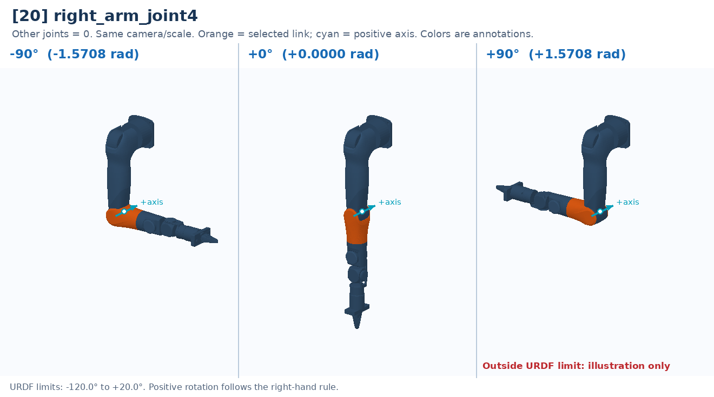

# [20] right_arm_joint4

Elbow bend: rotates the forearm relative to the upper arm.

Controller slot: `action[20]`. Command: **absolute angle in rad**.

Joint: `right_arm_link3` → `right_arm_link4`. Local positive axis: `[0.0, 1.0, 0.0]`.

URDF position limits: -2.0944 to 0.3491 rad. 

The three panels use identical camera and scale. All other joints are zero. Red labels identify illustrative poses that cannot be commanded. This is a motion explanation, not a collision-safe trajectory.

