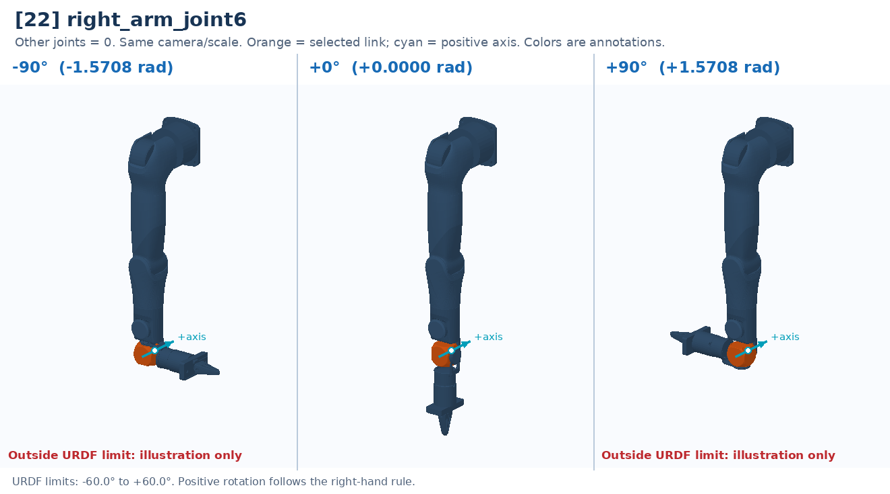

# [22] right_arm_joint6

Wrist bend: changes fingertip direction relative to the forearm.

Controller slot: `action[22]`. Command: **absolute angle in rad**.

Joint: `right_arm_link5` → `right_arm_link6`. Local positive axis: `[0.0, 1.0, 0.0]`.

URDF position limits: -1.0472 to 1.0472 rad. 

The three panels use identical camera and scale. All other joints are zero. Red labels identify illustrative poses that cannot be commanded. This is a motion explanation, not a collision-safe trajectory.

