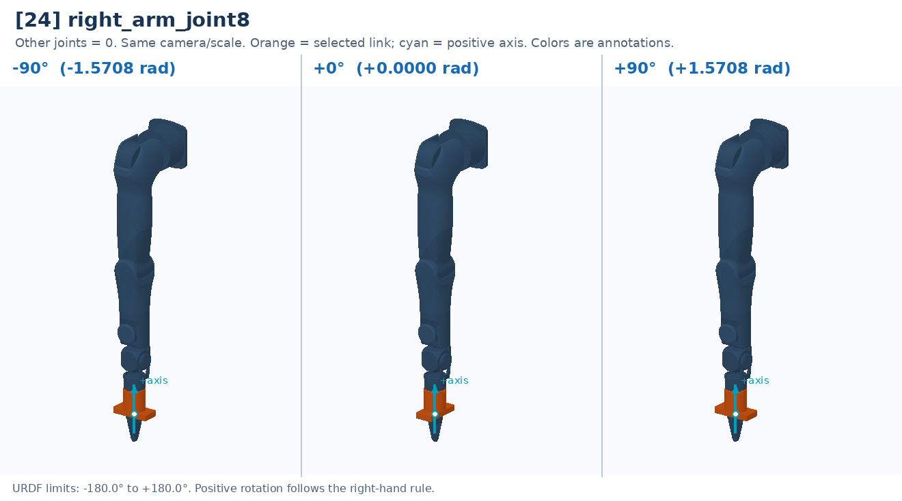

# [24] right_arm_joint8

Tool-axis roll. Direct joint commands can rotate it; baseline motion tools normally pin it at zero.

Controller slot: `action[24]`. Command: **absolute angle in rad**.

Joint: `right_arm_link7` → `right_gripper_link`. Local positive axis: `[0.0, 0.0, 1.0]`.

URDF position limits: -3.14159 to 3.14159 rad. 

The three panels use identical camera and scale. All other joints are zero. Red labels identify illustrative poses that cannot be commanded. This is a motion explanation, not a collision-safe trajectory.

