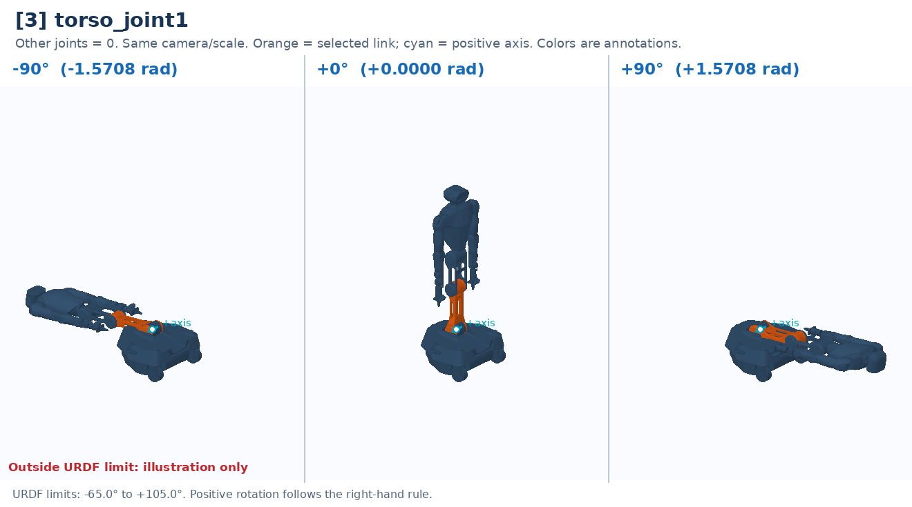

# [3] torso_joint1

Lower torso pitch; changes the trunk's lean and camera position.

Controller slot: `action[3]`. Command: **absolute angle in rad**.

Joint: `base_link` → `torso_link1`. Local positive axis: `[0.0, 1.0, 0.0]`.

URDF position limits: -1.1345 to 1.8326 rad. 

The three panels use identical camera and scale. All other joints are zero. Red labels identify illustrative poses that cannot be commanded. This is a motion explanation, not a collision-safe trajectory.

