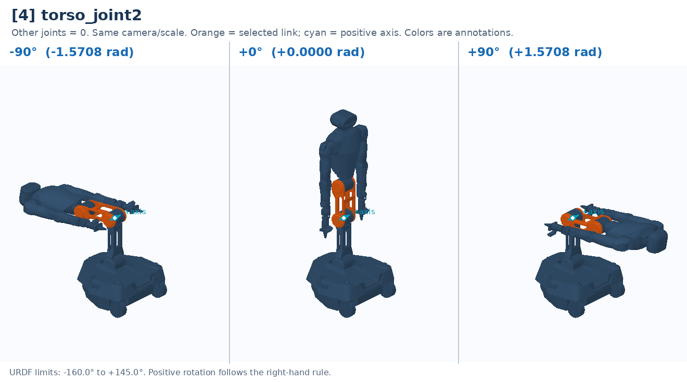

# [4] torso_joint2

Middle torso pitch; combines with T1/T3 to change height.

Controller slot: `action[4]`. Command: **absolute angle in rad**.

Joint: `torso_link1` → `torso_link2`. Local positive axis: `[0.0, 1.0, 0.0]`.

URDF position limits: -2.7925 to 2.5307 rad. 

The three panels use identical camera and scale. All other joints are zero. Red labels identify illustrative poses that cannot be commanded. This is a motion explanation, not a collision-safe trajectory.

