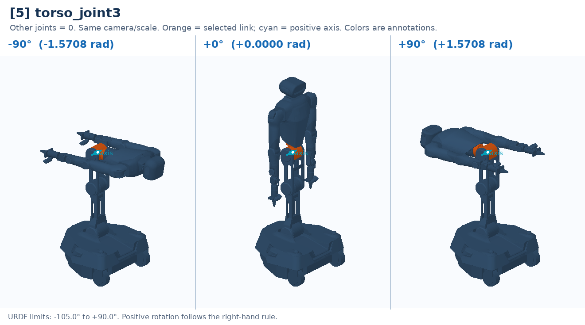

# [5] torso_joint3

Upper torso pitch; combines with T1/T2 to orient the chest/head.

Controller slot: `action[5]`. Command: **absolute angle in rad**.

Joint: `torso_link2` → `torso_link3`. Local positive axis: `[0.0, -1.0, 0.0]`.

URDF position limits: -1.8326 to 1.5708 rad. 

The three panels use identical camera and scale. All other joints are zero. Red labels identify illustrative poses that cannot be commanded. This is a motion explanation, not a collision-safe trajectory.

