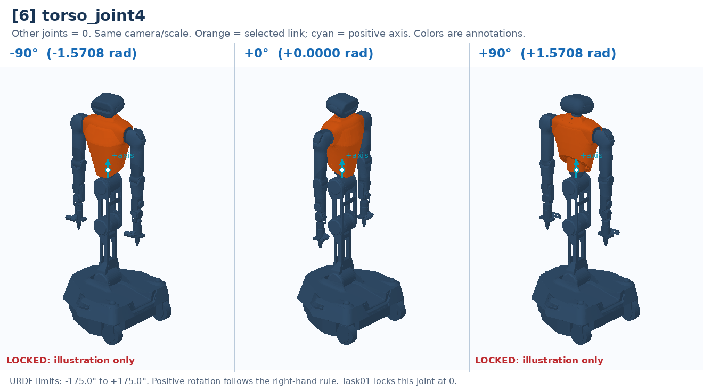

# [6] torso_joint4

Chest yaw. Locked at zero by the submitted evaluator profile.

Controller slot: `action[6]`. Command: **0 only (locked)**.

Joint: `torso_link3` → `torso_link4`. Local positive axis: `[0.0, 0.0, 1.0]`.

URDF position limits: -3.0543 to 3.0543 rad. The evaluator locks this joint at 0 regardless of the geometric limits.

The three panels use identical camera and scale. All other joints are zero. Red labels identify illustrative poses that cannot be commanded. This is a motion explanation, not a collision-safe trajectory.

